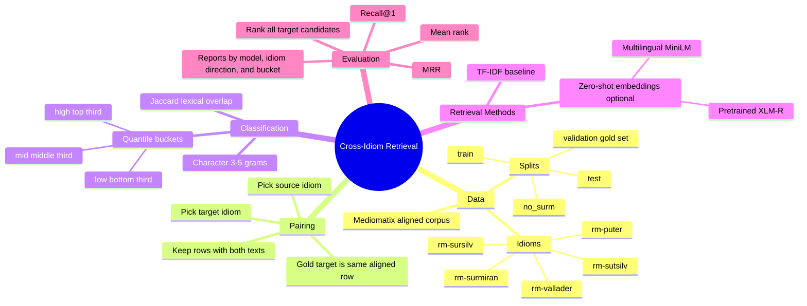
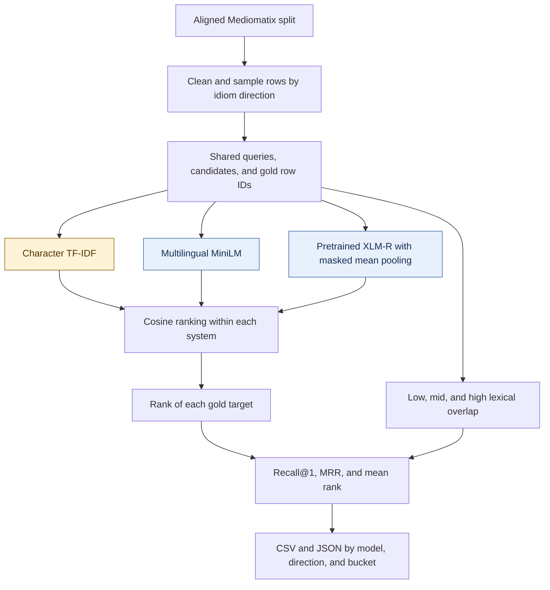
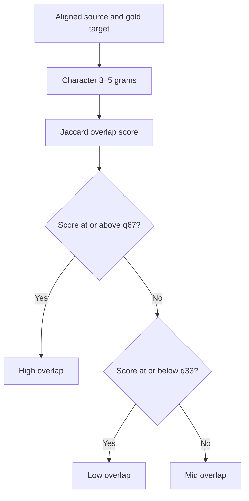

# Retrieval Pipeline Diagrams

Each idiom direction uses the same aligned queries, candidates, and lexical
overlap buckets for every selected retrieval system.

The validation figures show the three-system smoke check and the 20-direction
TF-IDF run. [Validation results](validation_results.md)

## Mind Map

## Process Flow

The default run uses TF-IDF. Add `--methods tfidf embeddings` to compare all
three systems. MiniLM uses its saved pooling. XLM-R averages the final token
vectors over non-padding positions. Both embedding models use L2 normalization
and a default limit of 128 input tokens.

## Lexical-Overlap Classification

The 33rd and 67th percentiles come from the sampled aligned rows for each idiom
direction. The high bucket takes precedence when both thresholds coincide.

## PCR-Style Summary

| Process | Classify | Report |
| --- | --- | --- |
| Clean and sample aligned rows for each idiom direction. | Assign overlap buckets from the source and gold target texts. | Rank candidates independently for each system and summarize by model, direction, and bucket. |

## Data Separation

| Split | Role in this branch |
| --- | --- |
| `train` | Available for later training/fine-tuning coordination. |
| `validation` | Default gold-standard retrieval evaluation split. |
| `test` | Held for final selected settings. |
| `no_surm` | Extra aligned split without Surmiran coverage. |

## Interpretation

High-overlap rows are the easiest lexical-control condition. Low-overlap rows
are the main RQ2 condition because they show where spelling similarity is less
helpful and semantic retrieval should matter more.
