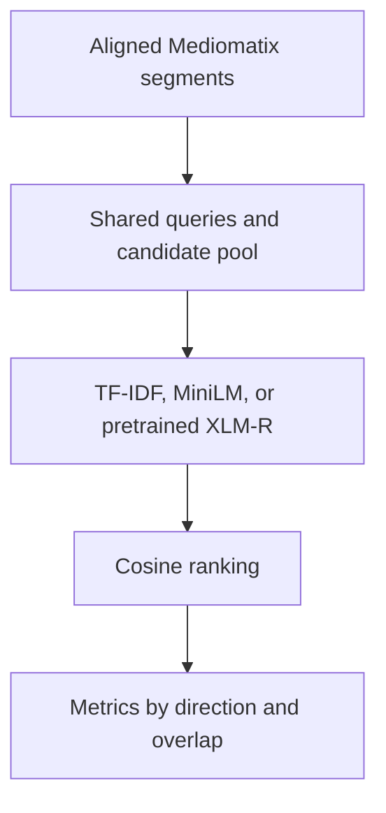

# Retrieval protocol and validation results

Mediomatix provides aligned schoolbook segments. For a chosen source and target idiom, the pipeline keeps rows with both texts and uses the target in the same row as the reference match. Every model ranks the same candidate pool by cosine similarity. The overlap groups use character 3–5-gram Jaccard scores between aligned texts and pair-specific 33rd and 67th percentiles. The high bucket takes precedence if both thresholds coincide.



## Three-system smoke check

`make smoke-embeddings` evaluates all three systems on the same 20 aligned
Sursilvan → Vallader queries and 20 candidates from the Mediomatix validation
split. The sample uses seed 13 and a 128-token limit for the embedding models.

| System | Correct at rank 1 | Recall@1 | MRR |
| --- | ---: | ---: | ---: |
| Character TF-IDF | 19 of 20 | 0.950 | 0.975 |
| Multilingual MiniLM | 17 of 20 | 0.850 | 0.892 |
| Pretrained XLM-R | 13 of 20 | 0.650 | 0.749 |

With the dependencies and validation data set up, rerun the smoke check and
summarize its CSV by model and overlap bucket.

```bash
make smoke-embeddings
python3 scripts/summarize_report.py reports/smoke_embeddings/retrieval_validation.csv
```

## TF-IDF validation across 20 idiom directions

This run evaluates character TF-IDF on 500 aligned rows per direction, for
10,000 retrieval queries. The figures in this section use that sample.

```bash
python3 scripts/run_retrieval.py --split validation --methods tfidf --max-rows 500
```

### Summary table

| Bucket | Rows | Recall@1 | MRR | Mean rank |
| --- | ---: | ---: | ---: | ---: |
| all | 10,000 | 0.815 | 0.856 | 7.52 |
| low | 3,300 | 0.540 | 0.628 | 20.47 |
| mid | 3,398 | 0.923 | 0.951 | 1.22 |
| high | 3,302 | 0.978 | 0.986 | 1.05 |

The three-system smoke check covers one direction with 20 candidates. The larger run covers 20 directions with 500 candidates each and uses TF-IDF only. Both use the validation split. The held-out test comparison is available in the [interactive playground](../../notebooks/retrieval_playground.ipynb).

The strongest directions in the larger run by Recall@1 were Puter → Vallader (0.974), Vallader → Puter (0.966), and Sutsilvan → Sursilvan (0.908). The weakest were Puter → Sutsilvan (0.738), Surmiran → Puter (0.742), and Surmiran → Vallader (0.744). In the low-overlap group, the four lowest scores were Surmiran → Puter (0.339), Surmiran → Vallader (0.358), Sursilvan → Surmiran (0.400), and Puter → Surmiran (0.412).
