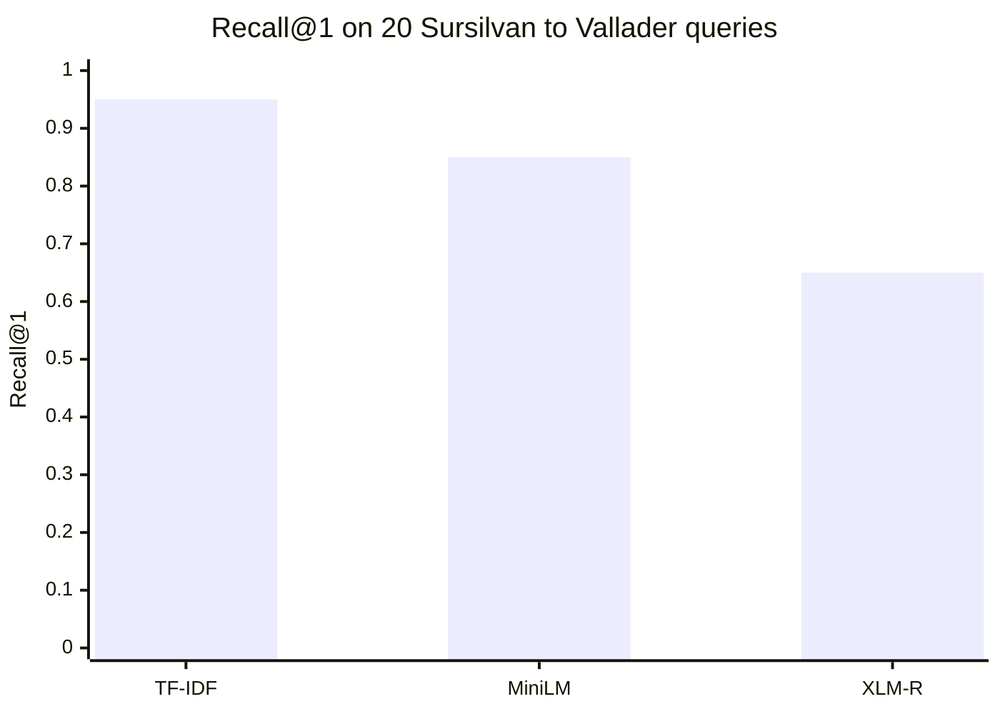
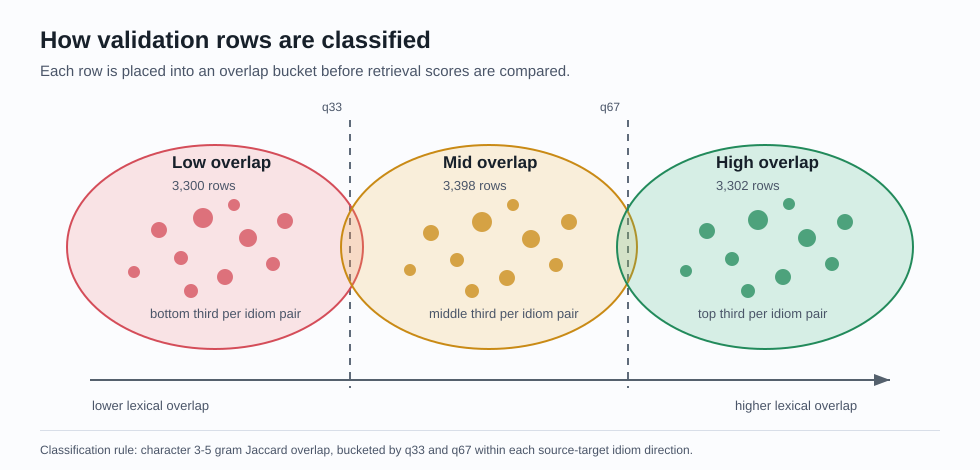
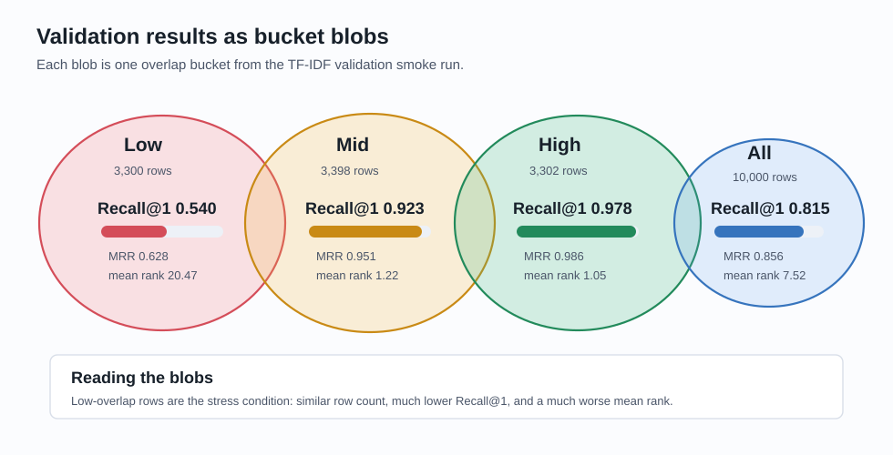
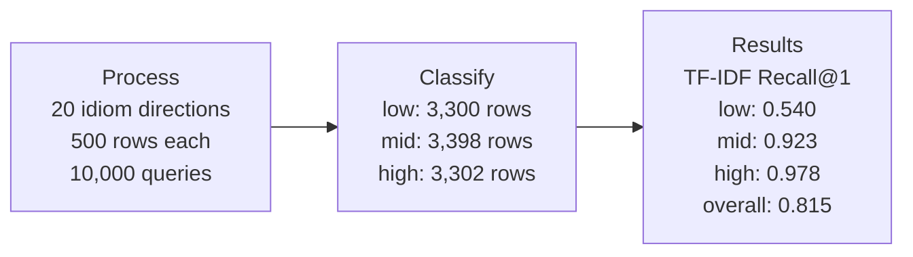
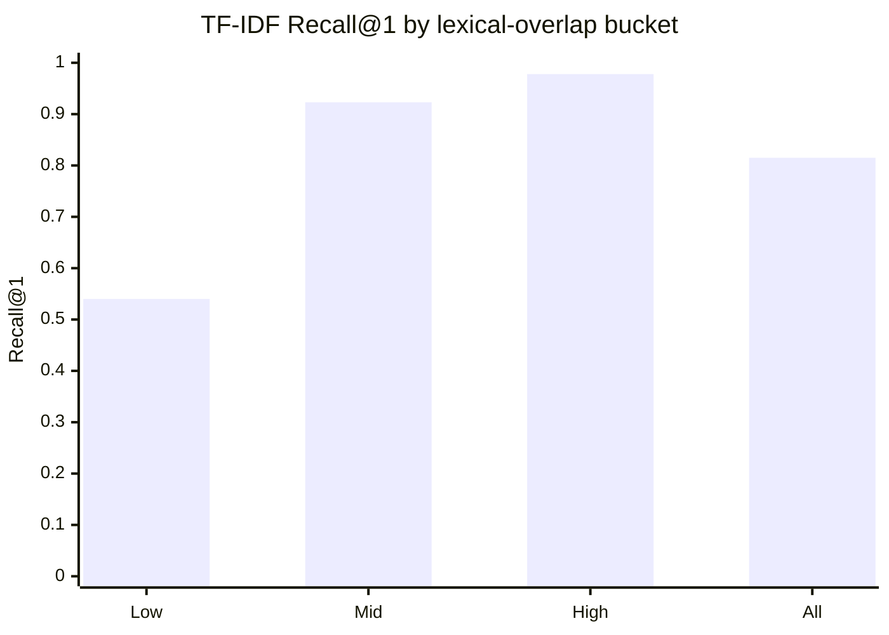
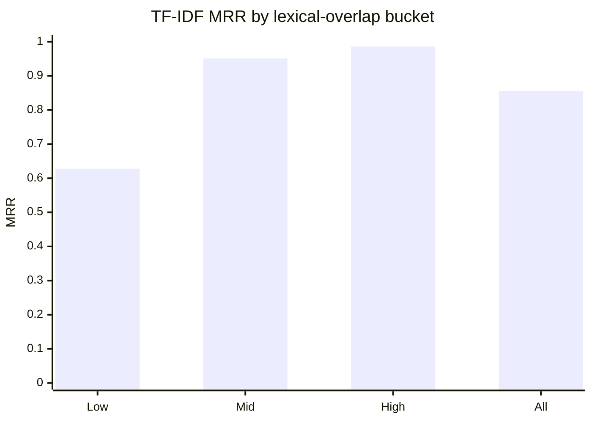
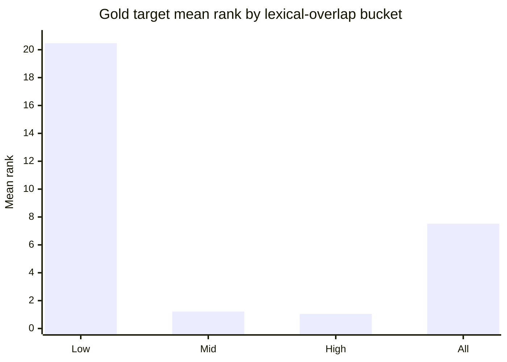
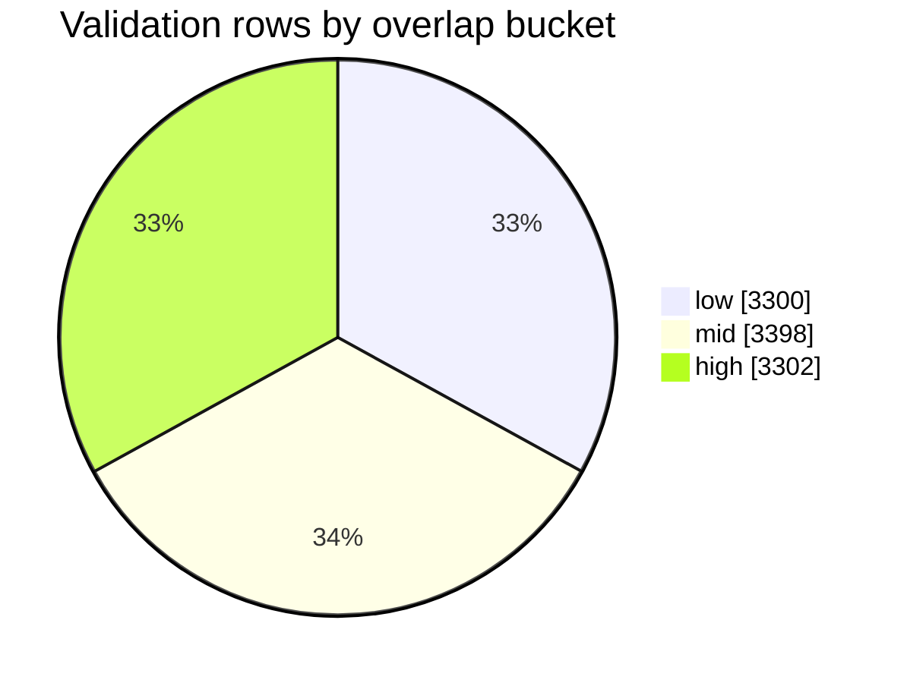
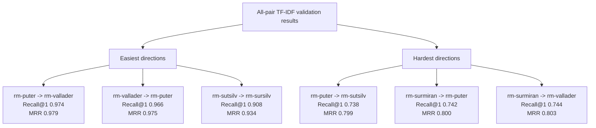
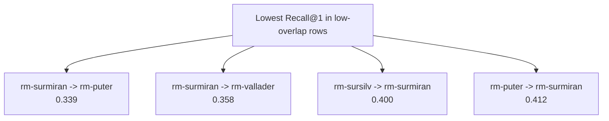

# Validation Results Diagrams

## Three-system smoke check

`make smoke-embeddings` evaluates all three systems on the same 20 aligned
Sursilvan → Vallader queries and 20 candidates from the Mediomatix validation
split. The sample uses seed 13 and a 128-token limit for the embedding models.



| System | Correct at rank 1 | Recall@1 | MRR |
| --- | ---: | ---: | ---: |
| Character TF-IDF | 19 of 20 | 0.950 | 0.975 |
| Multilingual MiniLM | 17 of 20 | 0.850 | 0.892 |
| Pretrained XLM-R | 13 of 20 | 0.650 | 0.749 |

With the dependencies and validation data set up, rerun the smoke check and
summarize its CSV by model and overlap bucket.

```bash
make smoke-embeddings
python3 scripts/summarize_report.py reports/smoke_embeddings/retrieval_validation.csv
```

## TF-IDF validation across 20 idiom directions

This run evaluates character TF-IDF on 500 aligned rows per direction, for
10,000 retrieval queries. The figures in this section use that sample.

```bash
python3 scripts/run_retrieval.py --split validation --methods tfidf --max-rows 500
```

### Classification blob view



This view shows the bucket assignment visually: rows are first separated by
their pair-specific lexical-overlap quantiles, then each bucket is evaluated.

### Result blob view



TF-IDF Recall@1 drops from 0.978 in the high-overlap bucket to 0.540 in the
low-overlap bucket.

### Process, classification, and results



### Recall@1 by overlap bucket



### MRR by overlap bucket



### Mean rank by overlap bucket



### Row distribution



### Easiest and hardest directions



### Low-overlap stress cases



### Summary table

| Bucket | Rows | Recall@1 | MRR | Mean rank |
| --- | ---: | ---: | ---: | ---: |
| all | 10,000 | 0.815 | 0.856 | 7.52 |
| low | 3,300 | 0.540 | 0.628 | 20.47 |
| mid | 3,398 | 0.923 | 0.951 | 1.22 |
| high | 3,302 | 0.978 | 0.986 | 1.05 |
